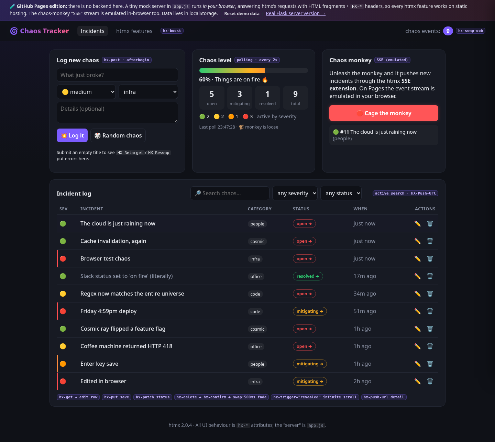

# 🌀 Chaos Tracker: an htmx 2.x demo

**Live demo:** https://cmoser965.github.io/htmx-chaos-tracker/

A playful incident log ("things going wrong") that shows off a broad set of htmx features:
active search, click-to-edit, out-of-band swaps, polling, server-triggered events, infinite
scroll, history/push-url, SSE and boosted navigation. Each feature is labelled in the UI with a
little purple `hx-…` badge.

This repo has two versions:

| Folder | What it is |
|---|---|
| [`server/`](server/) | The **real** version: a Flask app that returns HTML fragments and `HX-*` headers, with a real SSE stream. Run it locally (see [`server/README.md`](server/README.md)). |
| [`docs/`](docs/) | The **GitHub Pages** version. Pages is static-only, so `docs/app.js` replaces `XMLHttpRequest` with an in-browser mock server. It answers htmx's normal requests with the same HTML fragments and response headers (`HX-Trigger`, `HX-Retarget`, `HX-Reswap`, `HX-Push-Url`). The chaos-monkey SSE stream is emulated by a fake `EventSource` handed to the official htmx SSE extension (`htmx.createEventSource`). Data is kept in `localStorage`. |

The markup and `hx-*` attributes are the same in both versions. Only the thing answering the requests differs.

## Run the real server

```bash
cd server
python3 -m venv .venv && .venv/bin/pip install -r requirements.txt
.venv/bin/python app.py      # http://localhost:8000
```

## Run the Pages version locally

It needs to be served from a sub-path, like it is on github.io:

```bash
mkdir -p /tmp/site && ln -s "$PWD/docs" /tmp/site/htmx-chaos-tracker
python3 -m http.server 8100 -d /tmp/site   # http://localhost:8100/htmx-chaos-tracker/
```

## htmx features demonstrated

| Feature | Where in the UI | Attributes / headers |
|---|---|---|
| AJAX form | "Log new chaos" card | `hx-post`, `hx-target`, `hx-swap="afterbegin"`, `hx-disabled-elt` |
| Form reset via server event | After logging | `HX-Trigger: chaos-logged` + `hx-on:chaos-logged="this.reset()"` |
| Server-side validation retargeting | Submit an empty title | `HX-Retarget`, `HX-Reswap` |
| Active search | Search box and filters | `hx-trigger="input changed delay:300ms, search"`, `hx-include`, `hx-indicator`, `hx-sync` |
| Bookmarkable filters | Address bar while filtering | `HX-Push-Url` response header |
| Click-to-edit | ✏️ on a row (Save or Enter) | `hx-get`, `hx-put`, `hx-include="closest tr"`, `hx-trigger="keyup[key=='Enter']"` |
| Status workflow | Status pill | `hx-patch`, `hx-target="closest tr"` |
| Delete with confirm and fade | 🗑️ on a row | `hx-delete`, `hx-confirm`, `hx-swap="outerHTML swap:500ms"` + `.htmx-swapping` CSS |
| Polling | Chaos level card | `hx-trigger="every 2s"` |
| Out-of-band swaps | Header counter, stats card | `hx-swap-oob` |
| Toasts | Bottom right | `HX-Trigger: {"showToast": …}` (+ ~15 lines in `toast.js`) |
| Infinite scroll | Bottom of the incident log | `hx-trigger="revealed"` |
| Detail drawer with history | Click an incident title | `hx-push-url`, `hx-select` (close) |
| Live push | 🐒 Chaos monkey | SSE extension: `hx-ext="sse"`, `sse-connect`, `sse-swap` |
| Boosted navigation | Top nav | `hx-boost` |

## Pages-specific notes

- Routes use query strings (`?event=5`, `?q=dns`, `?page=about`), so refreshing a pushed URL always works on Pages. `404.html` sends any other path back to the app.
- htmx 2.0.4 and htmx-ext-sse 2.2.2 are vendored in `docs/`, so there's no CDN dependency.
- The "server" runs in your tab. Every visitor has their own data, and the chaos monkey only reaches the tab it runs in. With the real Flask server it pushes to every connected tab.


