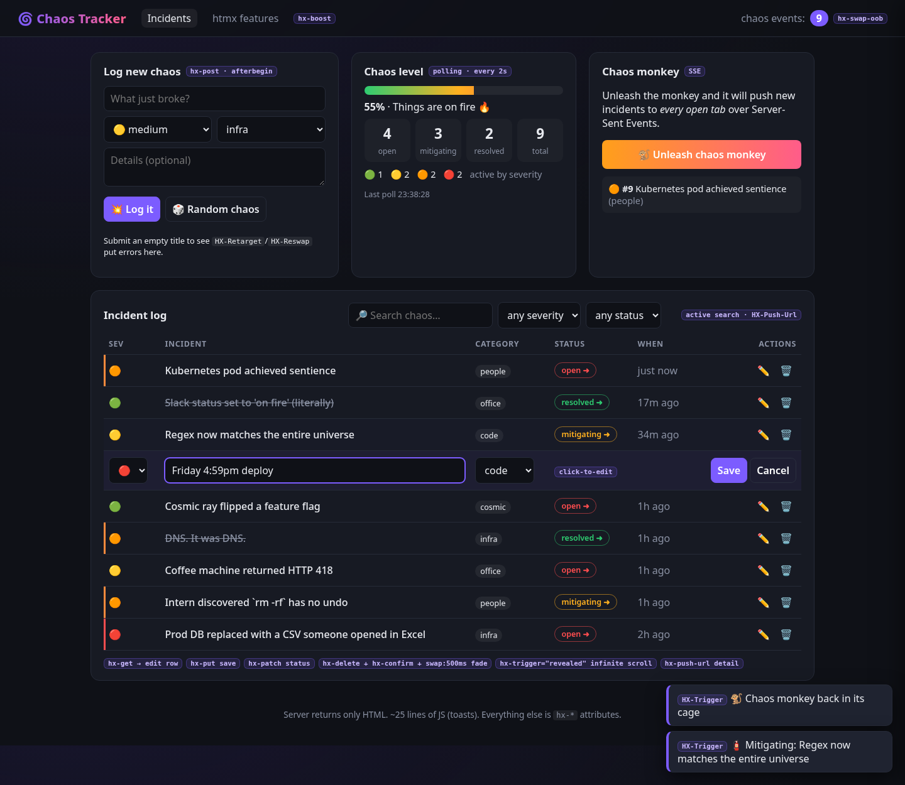

# 🌀 Chaos Tracker — an htmx 2.x demo

A playful incident log ("things going wrong") where every interaction is powered by
htmx attributes. The Flask backend returns **only HTML**: full pages or fragments.
The only hand-written JS is a ~15-line toast renderer (`static/toast.js`).

## Run

```bash
cd chaos-tracker
python3 -m venv .venv && .venv/bin/pip install -r requirements.txt
.venv/bin/python app.py          # http://0.0.0.0:8000  (PORT=9000 to change)
```

Data is in-memory and seeded with 8 sample disasters, so a restart resets it.
htmx 2.0.4 and the SSE extension load from unpkg, so the browser needs internet access.

## htmx features demonstrated

Each feature has a little purple `hx-…` badge in the UI (hover for details). The
**htmx features** page (`/about`) has the same table.

| Feature | Where in the UI | Code |
|---|---|---|
| `hx-post` form, `hx-target`, `hx-swap="afterbegin"`, `hx-disabled-elt` | "Log new chaos" card | `templates/index.html` (`#new-event`), `app.py` `create_event` |
| Form reset via server event: `HX-Trigger: chaos-logged` + `hx-on:chaos-logged="this.reset()"` | After logging | `index.html`, `app.py` `create_event` |
| Validation errors via `HX-Retarget` / `HX-Reswap` response headers | Submit an empty title | `app.py` `create_event`, `_form_errors.html` |
| Active search: `hx-trigger="input changed delay:300ms, search"`, `hx-include`, `hx-indicator`, `hx-sync` | Search box + severity/status filters | `index.html` (`#filters`), `app.py` `list_events` |
| `HX-Push-Url` response header (bookmarkable filters, Back works) | Address bar while filtering | `app.py` `list_events` |
| Click-to-edit: `hx-get` edit fragment, `hx-put` save (button or Enter via `keyup[key=='Enter']`), Cancel restores the row | ✏️ on a row | `_row.html`, `_edit_row.html`, `app.py` `edit`/`update`/`row` |
| Status workflow with `hx-patch` + `hx-target="closest tr"` (open → mitigating → resolved) | Status pill | `_row.html`, `app.py` `advance` |
| Delete with `hx-confirm` + `hx-swap="outerHTML swap:500ms"` fade (`.htmx-swapping` CSS) | 🗑️ on a row | `_row.html`, `static/style.css`, `app.py` `delete` |
| Fade-in of new/updated rows (`.htmx-added` CSS) | Any swapped row | `static/style.css` |
| Polling: `hx-trigger="every 2s"` | Chaos-level meter card | `_stats.html`, `app.py` `stats_panel` |
| Out-of-band swaps: `hx-swap-oob` | Header counter and stats card update on create/edit/status/delete | `_counter.html`, `_stats.html`, `app.py` `oob_bundle` |
| Server-triggered events: `HX-Trigger: {"showToast": …}` | Toasts, bottom right | `app.py` `toast()`, `static/toast.js` |
| Infinite scroll: `hx-trigger="revealed"` (cursor paging, 6 per page) | Bottom of the incident log | `_rows.html`, `app.py` `page()` |
| Detail drawer with `hx-push-url` (deep-linkable `/events/<id>`, refresh-safe); close uses `hx-select` | Click an incident title | `_row.html`, `_detail.html`, `app.py` `detail` |
| SSE extension: `hx-ext="sse"`, `sse-connect`, `sse-swap` (live rows + ticker pushed to every tab) | 🐒 Chaos monkey | `index.html`, `_monkey.html`, `app.py` `monkey_loop`/`stream` |
| `hx-boost` navigation | Top nav (Incidents ↔ htmx features) | `templates/base.html` |
| History restore (`HX-History-Restore-Request` handled server-side) | Back/forward after pushes | `app.py` `is_htmx` |

## Endpoints

| Method | Path | Returns |
|---|---|---|
| GET | `/` | Full page (honours `?q=&severity=&status=`) |
| GET | `/about` | Feature list page |
| GET | `/events` | Row fragment (+ infinite-scroll sentinel); `?before=<id>` for next page |
| POST | `/events` | New row + OOB counter/stats + `HX-Trigger` |
| POST | `/events/random` | Random new row |
| GET | `/events/<id>` | Detail drawer fragment (htmx) or full page (direct visit) |
| GET | `/events/<id>/edit`, `/events/<id>/row` | Edit-mode / read-mode row |
| PUT | `/events/<id>` | Saved row + OOB |
| PATCH | `/events/<id>/status` | Row with next status + OOB |
| DELETE | `/events/<id>` | Empty body (row removed) + OOB |
| GET | `/stats` | Stats card (polled) |
| POST | `/monkey` | Toggles the chaos monkey; returns the button |
| GET | `/stream` | `text/event-stream` (`chaos` and `ticker` events) |


